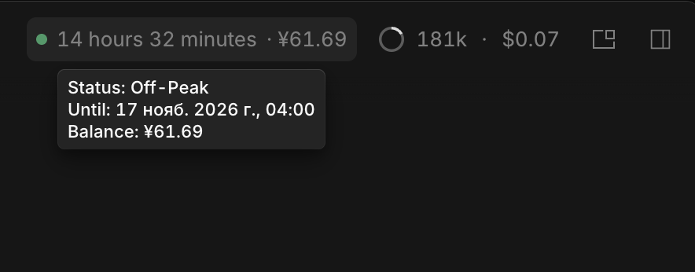

# DeepSeek Indicator for OpenCode Desktop v2

[](https://github.com/m1khal3v/opencode-deepseek-indicator/actions/workflows/ci.yml)

A GUI-only OpenCode Desktop plugin that shows the current DeepSeek API tariff
period and account balance in the session header.

<p align="center">
  
</p>

The dot is green in Off-Peak and red in Peak. The badge is placed directly to the
left of **Toggle session context**. The timer uses the two largest non-zero
units, and the balance follows it after a separator:

```text
● 2 hours 14 minutes · $4.82 + $5.55 bonus
```

Hovering shows a three-line tooltip:

```text
Status: Off-Peak
Until: 14 Nov 2026, 05:00
Balance: $10.37 ($4.82 + $5.55 bonus)
```

Clicking opens the official DeepSeek pricing page in the session's built-in
browser pane, or in the system browser when that pane is unavailable.

The tariff schedule, Chinese holidays and countdown are computed locally and
deterministically. The balance is requested from `https://api.deepseek.com`
only when a DeepSeek key is configured. The key is read and used only in the
Electron main process; it is never sent to a window or written to the log.

## Requirements

- OpenCode Desktop v2 with GUI plugin support (`@opencode/plugin/gui`).
- Network access to `api.deepseek.com` when a DeepSeek key is configured.
- Node.js 20+ and npm for building.

## Build

```bash
npm install
npm run bundle
```

The build writes a single CommonJS bundle:

```text
dist/gui-experimental.cjs
```

`package.json` exposes it as `./gui-experimental`, which is the entry OpenCode
Desktop loads. The same bundle contains both the window `setup` and the
Electron `main` entry.

The bundle is committed to the repository because OpenCode installs git plugins
without running lifecycle scripts. Rebuild and commit it whenever the source
changes:

```bash
npm run bundle
```

Keep the script named `bundle`, not `build`: npm and pacote treat a `build`
script as a git-dependency preparation trigger, which OpenCode does not support
for plugin installs.

For development, rebuild on every change:

```bash
npm run dev
```

## Install from GitHub

Add the git package to the `plugins` array in
`~/.config/opencode/opencode.jsonc`:

```jsonc
{
  "$schema": "https://opencode.ai/config.json",
  "plugins": [
    "opencode-deepseek-indicator@git+https://github.com/m1khal3v/opencode-deepseek-indicator.git"
  ]
}
```

Or let the CLI edit the config:

```bash
opencode plugin add 'opencode-deepseek-indicator@git+https://github.com/m1khal3v/opencode-deepseek-indicator.git'
```

OpenCode installs the package from GitHub into its plugin cache. Restart OpenCode
Desktop, or reload the plugin from **Settings → Extensions → Plugins**. Update a
git install with:

```bash
opencode plugin update
```

To pin a release instead of tracking `master`, append the tag:

```jsonc
"opencode-deepseek-indicator@git+https://github.com/m1khal3v/opencode-deepseek-indicator.git#v2.0.0"
```

### Upgrading from the old package name

Version 2 renamed the package from `opencode-deepseek-peak-indicator` to
`opencode-deepseek-indicator`. Remove the old entry from `plugins`, or remove
the old package, before adding the new one:

```bash
opencode plugin remove opencode-deepseek-peak-indicator
```

The plugin id is the package name, so the renamed package is a different plugin
to OpenCode and must not be configured alongside the old one.

### Local development install

For local work, point `plugins` at the absolute path to this directory:

```jsonc
{
  "$schema": "https://opencode.ai/config.json",
  "plugins": [
    "/Users/you/projects/opencode-deepseek-indicator"
  ]
}
```

The GUI reloads automatically after each `npm run bundle`.

## Behavior

### Schedule (UTC)

Peak periods run on Monday–Friday, except Chinese statutory holidays:

| Window | Period |
| --- | --- |
| `01:00–04:00` | Peak |
| `04:00–06:00` | Off-Peak |
| `06:00–10:00` | Peak |
| `00:00–01:00`, `10:00–24:00` | Off-Peak |

All weekends and Chinese statutory holidays are Off-Peak for the full day.

### Chinese holidays without a network

The following holidays are calculated offline:

- New Year: 1 January.
- Labour Day: 1–2 May (the 2025 State Council reform added 2 May).
- National Day: 1–3 October.
- Qingming: the day the Sun's apparent longitude reaches 15°, computed with
  Meeus' low-precision solar coordinates and a bisection between 3 and 6 April.
  The result is converted to the `Asia/Shanghai` calendar date (4 or 5 April,
  and rarely 6 April).
- Spring Festival: New Year's Eve plus lunar 1/1–1/3.
- Dragon Boat Festival: lunar 5/5.
- Mid-Autumn Festival: lunar 8/15.

Lunar dates come from the Chinese calendar built into V8/ICU via
`Intl.DateTimeFormat("en-US-u-ca-chinese", { timeZone: "Asia/Shanghai" })`.
Leap lunar months are rejected by requiring a purely numeric month, so a holiday
is never duplicated in a leap month.

Dynamically announced **调休** make-up workdays and extended breaks are not
computed without a network lookup. Consequently, weekends are always Off-Peak
even when the State Council makes one a working day.

### Countdown

The timer uses only the two largest non-zero units, with the exact rules below:

| Remaining | Display |
| --- | --- |
| days + hours | `2 days 15 hours` |
| days + minutes | `1 day 1 minute` |
| days only | `3 days` |
| hours + minutes | `14 hours 30 minutes` |
| hours only | `3 hours` |
| minutes only | `59 minutes` |
| seconds only | `45 seconds` |

A positive remainder below one second shows `1 second`, never `0 seconds`.
Digits use `font-variant-numeric: tabular-nums`, so the badge does not jitter.

### Balance

The key is selected from the OpenCode credential store in the main process: the
active DeepSeek key first, then the first stored DeepSeek key, and finally
`DEEPSEEK_API_KEY`.

The main process calls `GET https://api.deepseek.com/user/balance` with that key
and returns a snapshot over the plugin's typed IPC channel. The key itself never
crosses into the renderer. Without a key the badge shows only the status dot and
timer, and no request is made.

DeepSeek returns `total_balance`, `granted_balance` and `topped_up_balance` per
currency. Since `total_balance` already includes the granted amount, the badge
shows `topped_up_balance` as the primary amount and `granted_balance` as the
bonus:

- `USD` → `$4.82`
- `CNY` → `¥110.00`
- Any other currency → `EUR 4.82`
- A positive bonus adds ` + $5.55 bonus`
- A zero bonus is omitted

Multiple `balance_infos` entries are resolved separately for the main amount and
the bonus. Among funded entries the main entry prefers `USD`, then `CNY`, then
the first entry; the bonus uses the same priority. If the two amounts use
different currencies, the tooltip shows them separately instead of adding
different currencies together.

The balance is cached for **4 minutes 50 seconds**. The main process refreshes it
every **5 minutes** and pushes the snapshot to every open window. There are no
prompt or session-event hooks. A `401` or `403` clears the cached balance; a
temporary network error keeps the last successful value for up to 15 minutes.

### Appearance

The badge is a host `ctx.ui.Button` with the `ghost-muted` look, so it uses the
app's own typography, hover background and focus outline. In its resting state
it is transparent and has no border. The status dot follows the host's
dark/light appearance through `data-appearance` and keeps muted sage green and
terracotta colors.

The balance and timer use tabular figures. The bonus amount and the word `bonus`
use a muted amber that follows the host appearance: `#d48942` in dark mode and
`#b56318` in light mode.

The tooltip is `ctx.ui.Tooltip`, the same host component used by **Toggle
session context**, so it shares that button's 600 ms open delay, compact
appearance and animation. It shows the current status, the local date and time
of the next switch, and the balance when one is available. The stylesheet is
imported with `?inline` and registered through `ctx.add(Style, css)`.

## CI

GitHub Actions runs on every push and pull request to `master`:

- `npm run typecheck`
- `npm test`
- `npm run bundle`
- `git diff --exit-code -- dist`

The last step fails when `src/` changed but the committed
`dist/gui-experimental.cjs` was not rebuilt.

## Tests

```bash
npm test
```

The schedule tests cover all UTC boundaries, all seven timer branches, singular
and plural forms, the 2025–2028 fixed holidays, Qingming, the 2026 lunar
holidays, leap-month handling, weekends and the tooltip format. The balance
tests cover parsing, currency selection, mixed currencies, formatting, the
credential lookup and the cache, authentication and transient-error policies.

## Project layout

```text
src/
├── gui.tsx                   Plugin.define, shared clock and balance, Slot("session.header", order 9)
├── indicator.tsx             Solid badge: dot, timer, balance, tooltip, click handler
├── styles.css                Status-dot, balance and bonus palette
├── contract.ts               Balance schema and BalanceIpc
├── main.ts                   Credential lookup, DeepSeek request, five-minute refresh
├── balance.ts                Response parsing, currency selection, balance formatting
├── balance-controller.ts     Cache, in-flight deduplication and error policy
├── credential.ts             DeepSeek key selection
├── schedule.ts               Peak/Off-Peak status, next transition, timer formatting
├── holidays.ts               Chinese statutory holidays and the Qingming solar term
├── schedule.test.ts          Schedule, holiday and timer tests
├── balance.test.ts           Balance parsing and formatting tests
├── balance-controller.test.ts Cache and error policy tests
└── credential.test.ts        Key selection tests
```

## License

The solar-term calculation follows the published formulas from Jean Meeus,
*Astronomical Algorithms*. The lunar calendar is provided by the host's ICU data.
